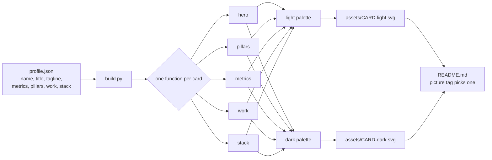

# svg-profile-kit

A small Python generator that turns one `profile.json` into animated SVG cards for a GitHub profile README, each written in a light and a dark version.

<picture>
  <source media="(prefers-color-scheme: dark)" srcset="assets/hero-dark.svg">
  
</picture>

Everything on this page is generated from the sample [`profile.json`](profile.json) for a made-up person, Alex Rivera. Switch your GitHub theme and the cards switch with it.



## Quickstart

Python 3.9+ and nothing else. `pytest` only for the tests.

```bash
git clone https://github.com/joshuaforwork10-sys/svg-profile-kit && cd svg-profile-kit
cp profile.json me.json           # edit me.json with your own content
python3 build.py me.json --snippet
```

Copy the `assets/` folder into your `<username>/<username>` profile repo and paste the printed `<picture>` blocks into its README. Run the tests with `python3 -m pytest -q`.

## Sample output

From a real run on the sample profile:

```text
$ python3 build.py --snippet
wrote assets/hero-light.svg + -dark.svg  (7,456 bytes)
<picture>
  <source media="(prefers-color-scheme: dark)" srcset="assets/hero-dark.svg">
  
</picture>
wrote assets/pillars-light.svg + -dark.svg  (6,707 bytes)
...
wrote assets/stack-light.svg + -dark.svg  (7,138 bytes)
```

And the cards themselves:

<picture>
  <source media="(prefers-color-scheme: dark)" srcset="assets/pillars-dark.svg">
  
</picture>

<picture>
  <source media="(prefers-color-scheme: dark)" srcset="assets/metrics-dark.svg">
  
</picture>

<picture>
  <source media="(prefers-color-scheme: dark)" srcset="assets/work-dark.svg">
  
</picture>

<picture>
  <source media="(prefers-color-scheme: dark)" srcset="assets/stack-dark.svg">
  
</picture>

## profile.json

| Key | Card | Notes |
|---|---|---|
| `name`, `title_lines` | hero | Required. Up to two title lines. Wrap a word in `{braces}` to color it with the accent. The title shrinks to fit. |
| `tagline` | hero | Two short lines. |
| `ticker` | hero | Rotating one-liners in the LIVE box. Long lines shrink to fit. |
| `flow` | hero | Up to four `inputs`, a two-line `hub` and a two-line `output` for the animated diagram. |
| `pillars` | pillars | Up to five. `icon` is one of `db`, `signal`, `send`, `table`, `spark`, `chart`. |
| `metrics` | metrics | Up to four. `before_value` and `after_value` size the bars, so lower-is-better and higher-is-better both work. |
| `work` | work | Any number, three per row. Text past two lines is cut with a warning. |
| `stack` | stack | Groups of tool names, laid out as wrapping pills, two groups per row. |
| `palette` | all | Optional overrides, for example `{"dark": {"acc": "#FF5A1F"}}`. |

Leave a section out and its card is skipped.

## How the light/dark switch works

GitHub's Markdown supports the HTML `<picture>` element with a `prefers-color-scheme` media query on each `<source>`:

```html
<picture>
  <source media="(prefers-color-scheme: dark)" srcset="assets/hero-dark.svg">
  
</picture>
```

Dark-theme viewers get the `-dark` file. Everyone else, plus any renderer that ignores `<source>`, gets the `` fallback.

## Design decisions

- **Two fixed palettes, not a media query inside the SVG.** An SVG shown through `` can carry its own `@media (prefers-color-scheme: dark)` block, but that query reads the browser or OS setting, not the theme the viewer picked on GitHub. Someone on a light OS with GitHub set to dark gets a light card on a dark page. With two files, the README picks the palette in the same place GitHub picks its own theme, and each file looks the same in every viewer (an editor preview, a chat link unfurl, a direct link). The tests check that no output file contains `prefers-color-scheme`.
- **One template, two outputs.** Each card is drawn once with CSS variables, then written twice with a different palette swapped in. The tests confirm that light and dark differ only in the palette, so the two versions can never drift apart.
- **Reduced motion is handled twice.** CSS animations stop under `prefers-reduced-motion: reduce`, and the first ticker line stays visible. SMIL `<animateMotion>` dots do not respond to CSS `animation: none`, so those elements carry a `mover` class that is hidden outright.
- **No font files, no dependencies.** Text width is estimated from character classes, which is close enough to size titles, wrap paragraphs and lay out pills with the system font stack. That keeps the kit to one stdlib Python file, and the SVGs to a few KB each.
- **Text problems are loud.** User text is XML-escaped (a `&` in a company name would otherwise break the file), and text that does not fit prints a warning instead of being cut silently.

## Layout

```text
build.py        the generator: palettes, primitives, one function per card
profile.json    sample content for a made-up person, Alex Rivera
assets/         generated SVGs, committed so this README can show them
tests/          pytest suite: output files, XML validity, palettes, motion, escaping
```

## License

MIT
